<picture><source media="(max-width: 600px)" srcset="header-mobile.svg"></picture>

<picture><source media="(max-width: 600px)" srcset="about-mobile.svg"></picture>

<picture><source media="(max-width: 600px)" srcset="skills-mobile.svg"></picture>

### My contributions

<picture><source media="(prefers-reduced-motion: reduce)" srcset="galaga-static.svg"></picture>

<picture><source media="(max-width: 600px)" srcset="footer-mobile.svg"></picture>

<a href="https://www.linkedin.com/in/guillermods/">LinkedIn</a>

